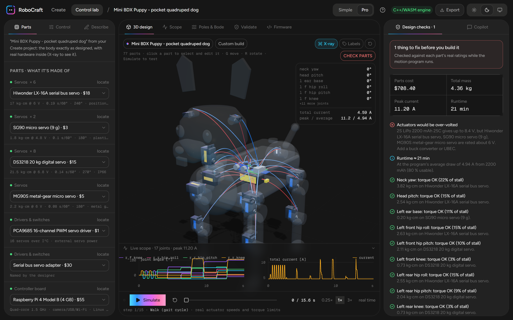
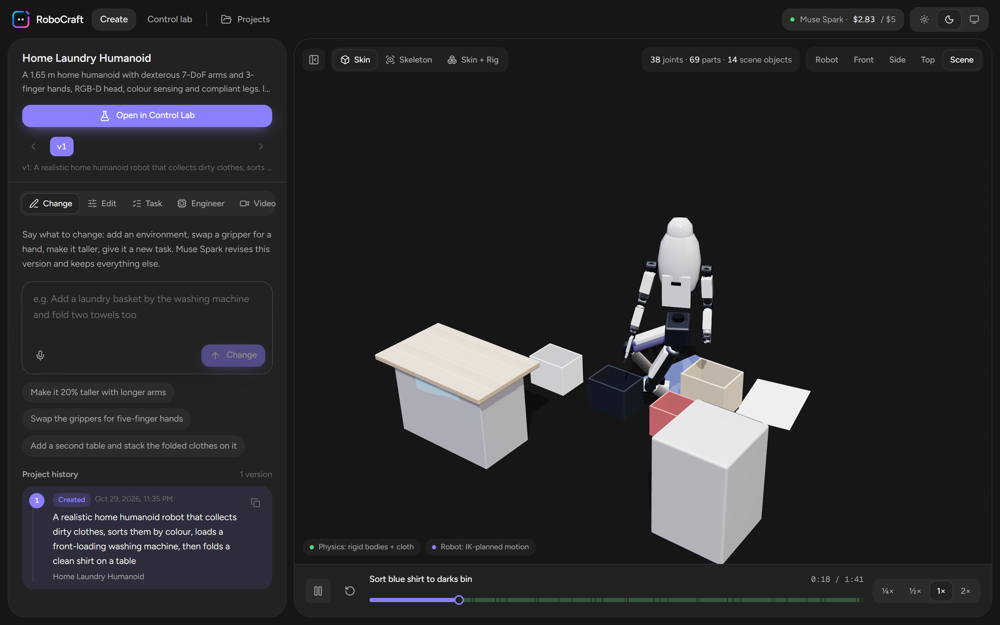
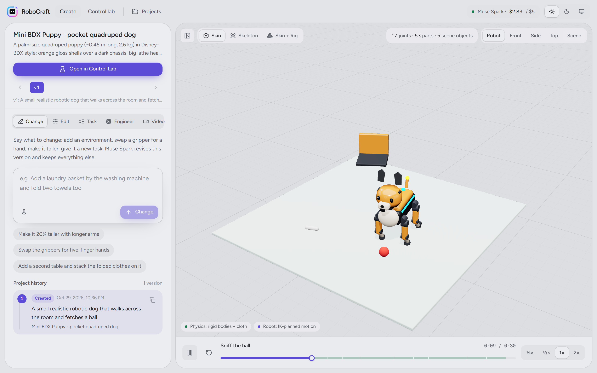
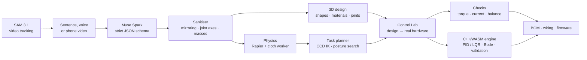
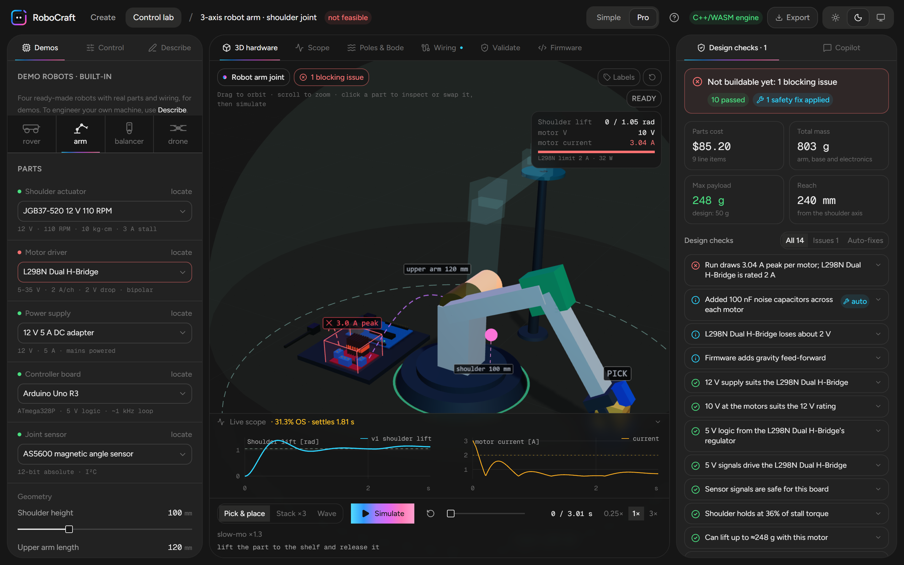
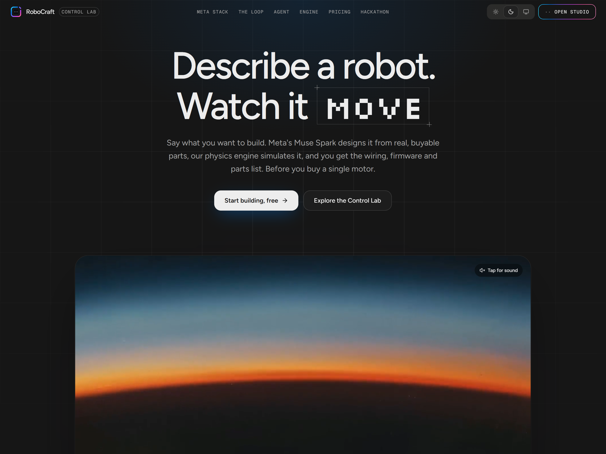
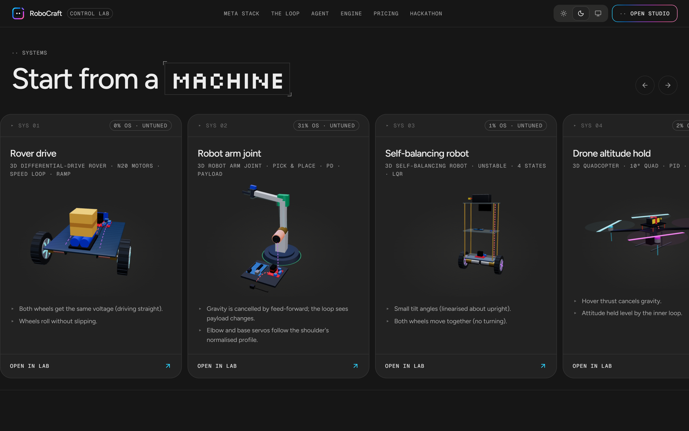

<p align="center">
  
</p>

<p align="center">
  <b>Text to a realistic, physics-simulated robot made of real, buyable parts, with the wiring, firmware and parts list to build it.</b>
</p>

<p align="center">
  <a href="https://robocraftlaunch.vercel.app"></a>
  
  
  
  
  
  
  
  
</p>

<p align="center">
  <a href="https://robocraftlaunch.vercel.app"><b>Live demo</b></a> ·
  <a href="https://robocraftlaunch.vercel.app/create">Create</a> ·
  <a href="https://robocraftlaunch.vercel.app/lab?preset=arm">Control Lab</a> ·
  <a href="#how-it-works">How it works</a> ·
  <a href="#how-we-use-metas-models">Meta models</a> ·
  <a href="#run-it-locally">Run it</a>
</p>

<br />

<p align="center">
  
  <br />
  <sub>A robot dog Muse Spark designed from one sentence, opened in the Control Lab in X-ray. The body is exactly as designed; inside are real servos, a servo driver, a Raspberry Pi and a battery, wired, priced ($708) and checked against their datasheet ratings while it walks.</sub>
</p>

---

## The problem

Building a robot today means stitching together five tools that don't talk to each other: a CAD
package for the body, a spreadsheet for the parts, a simulator you have to model everything in by
hand, a control-theory notebook, and an IDE for the firmware. Most people never get past the first
one. Those who do find out the motor was too weak **after** they've ordered it.

AI image and 3D generators don't fix this. They produce shapes, not machines: no joints that
move, no motors with real torque limits, nothing you could order and wire.

## What RoboCraft does

You describe a robot in a sentence. RoboCraft gives you a **machine**, not a mesh:

1. **A realistic 3D design** with articulated joints, actuators sized to the load, PBR materials,
   and the environment it works in (the laundry room, the warehouse shelf, the ball to fetch).
2. **Real physics.** Rigid bodies and cloth in [Rapier](https://rapier.rs), with inverse-kinematics
   motion planning, so you watch it actually try the task, step by step, and see which steps fail.
3. **Real hardware inside.** Every joint gets a real actuator from a library of datasheet-rated
   parts. The machine is wired to a real board, driver and battery, and checked live: torque,
   current, voltage, runtime, balance and reach.
4. **Everything to build it:** a priced bill of materials with suppliers, a wiring diagram, and
   firmware generated for the board.

Change it by talking to it ("make it 20% taller", "swap the grippers for five-finger hands"), edit
any part by hand, or film the real robot and let SAM 3.1 compare it with the simulation.

<table>
  <tr>
    <td width="50%"></td>
    <td width="50%"></td>
  </tr>
  <tr>
    <td><sub><b>Create.</b> "A home humanoid that sorts laundry, loads the washer and folds a shirt": 38 joints, 69 parts, 14 scene objects, a 39-step task planned with IK and simulated with cloth.</sub></td>
    <td><sub><b>Same studio, light theme.</b> A pocket quadruped that trots to a ball. Every version of every project is kept, with its full prompt history.</sub></td>
  </tr>
</table>

## How it works



**1. Design.** Muse Spark answers in a strict JSON schema (`robot_design`): free-form shapes
(box, cylinder, capsule, lathe, extrude, tube, torus…), PBR materials, a joint tree with axes,
limits and actuators, effectors, the scene, a task plan and a hardware block. A long designer
guide teaches it build quality, human-scale proportions, actuator sizing, mirroring and mobility.

**2. Sanitise.** Model output is never trusted blindly. `sanitizeDesign` mirrors left/right limbs,
repairs joint housing orientation and elbow/knee axes, computes masses from real material
densities and hollow-shell volumes, and clamps everything to physical ranges. Saved projects are
re-sanitised on load, so old designs pick up every fix.

**3. Simulate.** Rapier rigid bodies plus a Verlet cloth solver run in a Web Worker. Each task
step (reach, grasp, lift, place, fold, walk, fly) is planned with closed-loop CCD inverse
kinematics and a posture search (crouch, lean from the pelvis, shift the base), then checked
against joint torque, balance, reach and collisions. The result is a recording you can scrub.

**4. Engineer.** `designToAssembly` turns the design into a machine without another AI call and
without changing the body: a shell per part, a real actuator per joint (picked by measured load
from a library from SG90 hobby servos to Dynamixel and CubeMars AK-series actuators, with the
shaft aligned to the joint axis), plus controller, power, sensors, a PWM or smart-servo bus,
wiring and a motion program. X-ray shows it all inside the body.

**5. Control and validate.** The Control Lab models the plant from part datasheets (motor R, Kt
and Ke from stall and no-load points, inertia from geometry, limits from the battery minus the
driver drop), proposes PID or LQR gains, and simulates in a dependency-free **C++ engine compiled
to WebAssembly** (RK4, dead time, saturation, noise, closed-loop poles, Bode margins, system ID).
Eight validation checks (stability, margins, specs, actuator limits, ±30% model error, sensor
noise, load disturbance, and a WASM-versus-TypeScript cross-check) run before you build.

## The Control Lab

<p align="center">
  
</p>

Every machine, whether from Create or one of the four built-in demos (rover, arm, self-balancing
robot, quadcopter), lands in a lab tailored to it:

| | |
|---|---|
| **Real, swappable parts** | 117 catalogue parts with datasheet ratings, prices and suppliers. Swap a motor and the physics, current draw, cost and checks all change. |
| **Design checks** | Driver voltage and current, stall and battery current, over- and under-volting, 5 V rails and level shifting, fuses and noise caps (auto-added), torque margins, payload, tip-over, thrust-to-weight, runtime. Each failure names the part and offers a one-click fix. |
| **Live 3D** | Motors glow with current, drivers heat past their rating, wires show current flow, failing parts get a callout. Play, scrub and slow-motion, synced to the scope. |
| **Copilot** | Explains *why* a response overshoots from the poles, damping and margins, in plain words, and proposes fixes with predicted metrics. Auto-tune runs a simulator-in-the-loop search in a worker that also keeps motor current inside the driver's rating. |
| **Firmware** | Arduino C++ for the same discrete controller, and per-machine firmware from the wiring pins, servo program and sensor rules. |
| **Simple and Pro** | Onboarding, a guided tour, a report card for beginners; Bode plots, poles and raw numbers for engineers. |

## How we use Meta's models

| Model | Where | What it does |
|---|---|---|
| **Muse Spark** (text) | `lib/create/ai.ts` | Designs a robot, its environment and its task from a sentence (`robot_design`), and revises it from a change request while keeping everything else (`robot_design_revision`). |
| **Muse Spark** (text) | `lib/lab/ai.ts` | Models a physical system as a plant (`plant_model`), designs a parts-level assembly (`machine_assembly`), explains a controller's response (`controller_advice`), reviews feasibility (`feasibility_review`), and finds a real part online with sources (`find_part`). |
| **Muse Spark** (vision) | `lib/create/ai.ts` | Reads keyframes from a phone video: the robot, its moving parts, the objects around it, and real sizes judged from things of known size (`video_scene`). That observation can seed a new design. |
| **SAM 3.1** | `lib/meta/sam.ts` | Tracks the robot's moving part through a real video. In Create the tracked path is overlaid on the simulated one, so you see where the model and the machine disagree. In the Control Lab the tracked boxes become step-response data that the engine fits a plant to. |
| **Muse Wonder, Muse Image** | landing film | The launch film on the landing page. |

### Built to respect a small credit budget

The whole hackathon ran on a $150 credit, so cost is engineered, not hoped for:

- **Off by default.** No live call happens unless `META_LIVE=1` and a key are set; every feature
  has an offline path (the physics library, the offline advisor, built-in demos).
- **Content-addressed cache.** Every response is stored under a hash of the full request, so a
  repeated request never costs twice and demos replay for free.
- **Daily cap.** Spend is logged per call with token counts and refused past
  `META_DAILY_BUDGET_USD`. The studio shows today's spend against the cap.
- **Tight outputs.** Strict JSON schemas and output limits on every call; video keyframes
  are downscaled to 640 px JPEGs before upload.
- **No AI where it isn't needed.** Hand-off to the Control Lab, the hardware conversion,
  firmware, checks and tuning are all deterministic code.

## The landing page

<p align="center">
  
</p>
<p align="center">
  
  <br />
  <sub>The machine cards are not pictures: each is the real rig, built from the lab's parts and driven by the same simulation, mounted only while on screen.</sub>
</p>

## Tech stack

| Layer | |
|---|---|
| App | Next.js 16 (App Router, Turbopack), React 19, TypeScript, Tailwind CSS v4, Motion, Zustand, Zod 4 |
| 3D | Three.js r186, React Three Fiber 9, drei, custom procedural geometry (lathe, extrude, tube, bins) |
| Physics | Rapier 3D (rigid bodies, joints, contacts), Verlet cloth with a broad phase, both in a Web Worker |
| Control engine | C++17, no dependencies, flat C ABI, compiled to WebAssembly with Emscripten (about 94 KB); TypeScript fallback |
| AI | Meta Muse Spark (text and vision) and SAM 3.1 through the Meta Model API, server-side only |
| Deploy | Vercel (one project, `vercel.json` routes the Next.js app and the Python service) |
| Tests | Vitest (124 tests), native engine tests (21 analytic checks), pytest for the Python engines |

## Repository layout

```
.
├── frontend/                 Next.js app (everything the user sees)
│   ├── src/app/              landing, /create, /lab, API routes (/api/create, /api/lab/*)
│   ├── src/components/       create/ (studio), lab/ (Control Lab, hw3d/ rigs), landing/
│   ├── src/lib/create/       design schema + sanitiser, Muse prompts, geometry, materials,
│   │                         kinematics, Rapier sim + worker, cloth, engineering, projects
│   ├── src/lib/lab/          hardware engine, parts catalogue, design → assembly, analysis,
│   │                         validation, advisor, codegen, firmware, video → step data
│   ├── src/lib/meta/         Meta API client (cache, cap, usage log) and SAM 3.1
│   └── tests/                Vitest suites and hand-written design fixtures
├── engine/                   PlantSim: C++17 control engine → WebAssembly
├── backend/                  FastAPI engines from the first prototype (kinematics, electrical, codegen)
└── vercel.json
```

## Run it locally

Requires Node 20+.

```bash
cd frontend
npm install
cp .env.example .env.local
npm run dev
```

Open http://localhost:3000. The Control Lab demos, physics, parts, checks and firmware all work
without a key. To design new robots with Muse Spark, set these in `.env.local`:

```bash
MODEL_API_KEY=your-meta-model-api-key
META_LIVE=1
META_DAILY_BUDGET_USD=5
```

On Vercel, add the same three variables (the key as a Secret) and redeploy.

<details>
<summary><b>Rebuilding the C++ engine</b></summary>

`engine/` is a dependency-free C++17 library with a flat C ABI (`src/api.cpp`). The compiled
`plantsim.wasm` is checked in, so deployments don't need Emscripten.

```bash
npm run engine:test   # native build + 21 analytic checks; writes engine/tests/golden.json
npm run engine:wasm   # needs Emscripten on PATH; writes frontend/public/engine/plantsim.wasm
```

If the WASM file is missing, the app falls back to a TypeScript port of the same engine, and the
validation suite cross-checks the two.
</details>

## Testing

```bash
cd frontend
npm test              # 124 Vitest tests: design sanitising, kinematics, IK, simulation,
                      # design → assembly, firmware, hardware checks, validation
npm run lint
npm run typecheck
```

## What's next

- **One-click flashing** of the generated firmware over Web Serial.
- **URDF and STEP export** so a design can go straight into ROS 2 and CAD.
- **Closing the loop with the real robot:** SAM 3.1 tracking from a live camera, with the
  simulation's parameters fitted to what the camera sees.
- **Shareable projects** and accounts, instead of browser-only storage.

---

<p align="center">
  Built for the Meta hackathon, <i>Push the Frontier</i>, by <a href="https://github.com/aboderinsamuel">Samuel Aboderin</a>.
</p>
